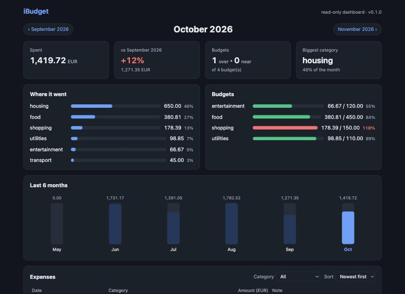
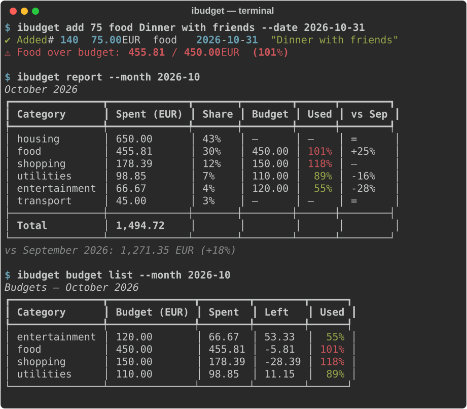

# iBudget

A simple command-line tool for managing personal expenses, with a small read-only web dashboard.

Record what you spend, group it into categories, set monthly budgets, import bank statements as CSV, and see monthly reports in the terminal or in the browser. All data stays on your machine in one SQLite file.

- Requirements: [docs/requirements.md](docs/requirements.md)
- How AI was used to build it: [docs/ai-journal.md](docs/ai-journal.md)





## Setup

Requires Python 3.14.

```bash
python3.14 -m venv .venv
.venv/bin/pip install -e ".[dev]"
.venv/bin/ibudget --help
```

Data is stored in your user data directory. Set `IBUDGET_DB=/path/to/file.db` or pass `--db PATH` to use another database.

## Commands

| Command | What it does |
|---|---|
| `ibudget add AMOUNT CATEGORY [NOTE] [--date YYYY-MM-DD]` | Add an expense (date defaults to today) |
| `ibudget list [--month YYYY-MM \| --all] [--category C] [--min N] [--max N] [--sort date\|amount] [--limit N]` | List expenses of this month (or the given one) with a total |
| `ibudget edit ID [--amount] [--category] [--date] [--note]` | Change an expense |
| `ibudget delete ID [--yes]` | Delete an expense |
| `ibudget category list` | Categories with their number of expenses and budget |
| `ibudget category add NAME` | Add a category |
| `ibudget category rename OLD NEW` | Rename a category; its expenses and budget follow |
| `ibudget category delete NAME [--reassign-to C] [--yes]` | Delete a category; one that has expenses needs `--reassign-to` |
| `ibudget budget set CATEGORY AMOUNT` | Set a monthly budget; `add` warns at 90% and when it is exceeded |
| `ibudget budget list [--month YYYY-MM]` | Budgets with spent, left and % used |
| `ibudget budget remove CATEGORY` | Remove a budget |
| `ibudget report [--month YYYY-MM]` | Spending per category: share, budget usage and change vs the previous month |
| `ibudget import FILE [--map date=Col,amount=Col,note=Col,category=Col] [--date-format FMT] [--default-category C] [--signed] [--dry-run]` | Import a CSV (e.g. a bank statement); re-importing skips duplicates |
| `ibudget export [--month YYYY-MM] [--output FILE]` | Export as CSV (stdout by default); the file can be imported again |
| `ibudget serve [--host 127.0.0.1] [--port 8000]` | Start the read-only web dashboard |
| `ibudget config get [KEY]` / `ibudget config set KEY VALUE` | Show or change settings (`currency`, default `EUR`) |

### Importing a bank statement

```bash
ibudget import statement.csv \
  --map "date=Booking date,amount=Amount,note=Description" \
  --date-format %d.%m.%Y --signed --dry-run     # preview first, then run again without --dry-run
```

- The delimiter (`,` `;` or tab) is detected from the header line; amounts may use `12,50` or `1.234,56`.
- `--signed`: negative amounts are expenses, positive rows (income) are skipped. Without it every amount is taken as an expense.
- Rows whose category column matches a known category keep it; the rest go to `--default-category` (default `other`).

## Dashboard

```bash
ibudget serve            # http://127.0.0.1:8000
```

A read-only page for one month at a time: summary cards, where the money went, budget bars, the last 6 months and the expense table. Switching months, filtering by category and sorting swap parts of the page with [HTMX](https://htmx.org) instead of reloading it; the address bar always holds a shareable URL such as `/?month=2026-10&category=food`. To change data, use the CLI.

### Demo data

```bash
./demo/setup.sh                                   # creates .demo/ibudget.db with 6 months of sample data
.venv/bin/ibudget --db .demo/ibudget.db serve
```

## Development

```bash
.venv/bin/playwright install chromium   # once: the browser used by the browser tests
.venv/bin/pytest                        # tests
.venv/bin/pytest --cov=ibudget          # with coverage
.venv/bin/pytest -m "not browser"       # skip the browser tests (e.g. offline)
.venv/bin/ruff check .                  # lint
```

`tests/test_browser.py` drives the dashboard in headless Chromium with [Playwright](https://playwright.dev/python/): month links, trend bars, the category filter and sorting must swap in place without a full reload, and the address bar, tab title and back button must follow. HTMX is loaded from its CDN, so these tests need network access. Add `--headed --slowmo 500` to watch them run.

Project rules for AI agents are in [CLAUDE.md](CLAUDE.md). Agent skills live in `.agents/skills/` and are linked into `.claude/skills/` for Claude Code:

- [`add-ibudget-command`](.agents/skills/add-ibudget-command/SKILL.md): the checklist for adding or changing a CLI command (service → thin Typer wrapper → tests → docs).
- [`write-ibudget-tests`](.agents/skills/write-ibudget-tests/SKILL.md): how to test each layer here (fixtures, temporary database, fixed dates and cents, HTMX browser tests) and how to prove a new test can fail.
- [`change-ibudget-schema`](.agents/skills/change-ibudget-schema/SKILL.md): how to change the database schema so existing databases upgrade safely (versioned migration steps, a backup, an upgrade test from a frozen copy of the previous version).
