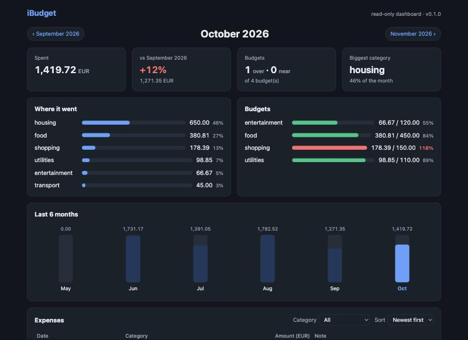
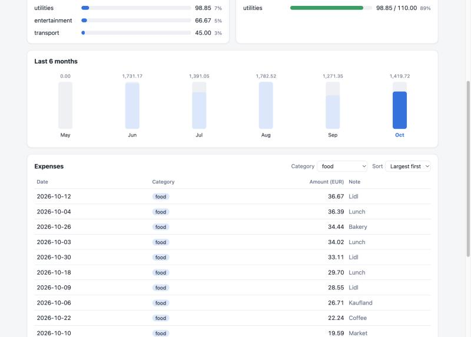
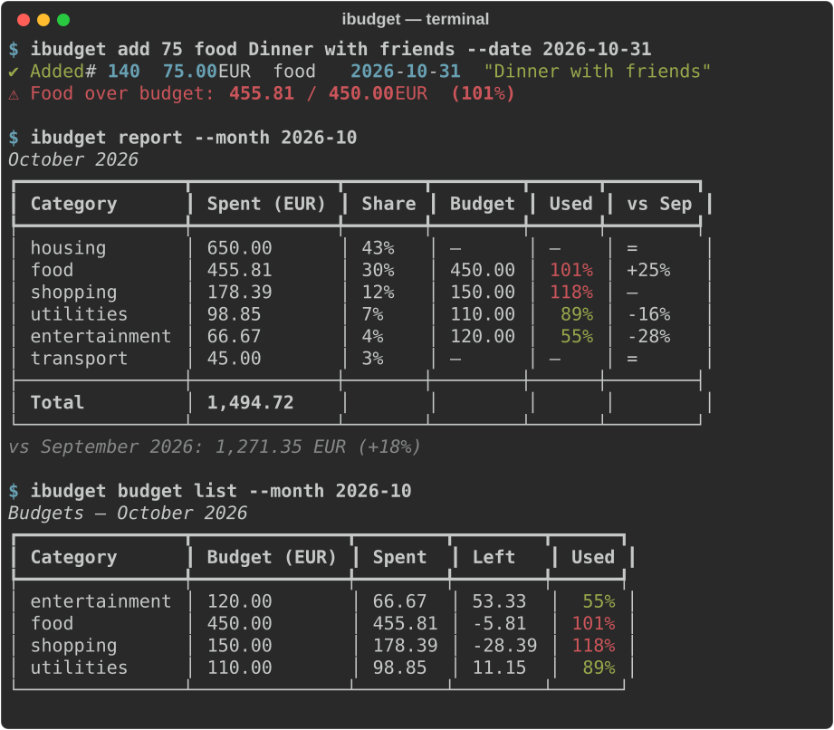

# iBudget: a personal expense tracker built with Claude Code

**AI-Assisted Development: Exam project**
**Repository:** https://github.com/sm1rnoff/iBudget
**Tool used:** Claude Code (Claude Opus 5.5) in the Claude desktop app; Claude Sonnet 5.5 for one comparison run

---

## 1. Idea and requirements

**Idea.** iBudget is a local, single-user tool for personal expenses. You record what you spend, group it into categories, set a monthly budget per category, import bank statements, and see where your money goes, either in the terminal or in a small read-only browser dashboard. All data stays on your machine in one SQLite file: no account, no server, no cloud sync.

**Main scenarios**
- **Daily logging:** run `ibudget add 12.50 food "Lunch"` right after paying. You get a warning when the food budget is nearly used up.
- **Monthly review:** run `ibudget report` at the end of the month, or `ibudget serve` to see the same numbers as bars and tables in the browser.
- **Catching up:** import the month's bank statement as CSV. Importing the same file again never creates duplicates.
- **Housekeeping:** add, rename or delete categories, and move their expenses elsewhere.

**Functional requirements**
- **Expenses:** add, list, edit and delete. The list filters by month, category and amount range, sorts by date or amount, and shows the total.
- **Categories:** eight defaults, which can be added to, renamed and deleted. A category that still has expenses can only be deleted by moving its expenses to another one (`--reassign-to`).
- **Budgets:** a monthly budget per category. `add` warns at 90% of the budget and when it is exceeded.
- **Monthly report:** total, share per category, budget usage, and change against the previous month.
- **CSV import and export:** import with column mapping, date formats and decimal commas, a `--dry-run` preview and duplicate detection. Export can be re-imported.
- **Settings:** the currency shown in output, e.g. `ibudget config set currency BGN`.
- **Dashboard:** `ibudget serve` opens a read-only HTMX dashboard. It shows summary cards, a category breakdown, budget bars, a 6-month trend and an expense table with a filter and sorting, all updated in place without page reloads.

**Non-functional requirements**
- Python 3.14, installable as a package.
- Money is always stored as integer cents, never as floats.
- Invalid input gives a clear message and exit code 1, never a stack trace.
- The CLI and the dashboard are thin layers over one shared core.
- The dashboard is read-only, runs on localhost only, and uses no JavaScript beyond HTMX.
- Every module has automated tests, `ruff` reports nothing, and coverage is at least 85%.

**Out of scope:** multiple users, currency conversion, editing data in the web UI, and cloud sync.

The full specification is in [`docs/requirements.md`](requirements.md).

## 2. System architecture: modules

I started in Claude Code's plan mode. Claude proposed three project ideas, asked clarifying questions, and then split the chosen system into modules, one git commit each. I reviewed that plan before any code was written. I changed it in four ways:
- I chose HTMX for the UI instead of Chart.js.
- I required category rename and delete, not only add.
- I set up the Python environment with plain `venv` and `pip` instead of `uv`.
- I asked for project skills to live in `.agents/skills/`.

| # | Module | Code |
|---|---|---|
| 1 | Data layer | `db.py`, `models.py`, `repository.py`, `money.py`, `period.py` |
| 2 | CLI layer and core services | `cli.py`, `services/expenses.py`, `services/categories.py`, `config.py` |
| 3 | Budgets and reports | `services/budgets.py`, `services/reports.py` |
| 4 | CSV import and export | `services/csv_io.py` |
| 5 | Web dashboard (HTMX) | `web/app.py`, `web/templates/`, `web/static/` |
| 6 | Testing layer | `tests/`: pytest, CliRunner, FastAPI TestClient, Playwright |

The rule that holds the design together, written into `CLAUDE.md` so every AI session follows it:
- All SQL lives in `repository.py`, and all logic lives in `services/`.
- `cli.py` and `web/` only parse input, call a service and render the result.

So the CLI and the dashboard show the same numbers from the same code.

## 3. Development process per module

### Module 1: Data layer

**Approach.** I wanted to settle the risky decisions first. Money is stored as integer cents. Amounts are parsed with `Decimal` and accept both `12,50` and `1.234,56`. Category names are unique regardless of letter case. Budgets disappear together with their category. A `Month` type handles month arithmetic for every other layer.

**Workflow**
1. Claude wrote the schema (with a version number for future upgrades), the dataclass models, the repository and the money and month helpers.
2. I reviewed the design and ran ruff; it flagged two over-long SQL lines, which Claude fixed.

**Testing.** 36 tests, each on its own temporary database. An automatic fixture points `IBUDGET_DB` at a temp file, so no test can touch real data.

**Tool and why.** Claude Code, because it could read the plan, write several related files at once, and run pytest and ruff itself.

**Key prompts**
- "Implement step 3 of the plan: db.py, models.py, repository.py, money.py with tests."

### Module 2: CLI layer and core services

**Approach.** Each command is a thin Typer wrapper around a service function. A single `_session()` context manager in the CLI opens the database and turns every user error into a red one-line message with exit code 1.

**Workflow**
1. Claude built `add`, `list`, `edit`, `delete`, the category commands and `config`.
2. I caught a usability bug: "Delete category?" was asked first, and only *then* did the command say the category still had expenses. Deleting is now split into a check and the actual delete, so the confirmation prompt can say "moving 2 expense(s) to other" before anything changes.
3. Claude captured this way of working as a reusable skill, `add-ibudget-command`. It is a checklist: logic in a service, a thin command, tests, then docs.

**Testing.** 30 tests: service tests, end-to-end tests through Typer's `CliRunner`, and a parametrized test that every user error exits with 1 and no traceback.

**Tool and why.** Claude Code. It applied the architecture rule from `CLAUDE.md` consistently across many commands.

**Key prompts**
- "Implement step 4 of the plan: CLI core with services for expenses, categories and config, and CliRunner tests."
- "User must be able to add/delete and modify categories."

### Module 3: Budgets and reports

**Approach.** The budget levels (ok / warning at 90% or more / over) live in one service function. The CLI, the report and later the dashboard all use it, so they can never disagree about a colour.

**Workflow**
1. Claude wrote the budgets and reports services and the `budget` and `report` commands.
2. Its first `report` decided the warning colours itself, which duplicated the budget rule. I had that moved into the service.
3. Later, the browser check showed 98.85 of 110.00 as "90%" in green. The real value is 89.86%, which was being rounded up. Percentages now round down, and there's a test for this case.

**Testing.** 19 tests:
- the exact thresholds (26999, 27000, 30000 and 30001 cents on a 300.00 budget);
- the month boundaries;
- a trend that crosses a year boundary;
- the warnings `add` prints.

**Key prompts**
- "Implement step 5 of the plan: budgets and reports services, budget and report commands, warning after add, with tests for month boundaries, empty months and the previous-month comparison."

### Module 4: CSV import and export

**Approach.** Bank statements are messy, so import needed a preview, duplicate detection and a clear list of the rows it skipped and why. It is tested against a realistic sample statement with semicolons, `dd.mm.yyyy` dates, `1.234,56` amounts, an income row and broken rows.

**Workflow.** Writing the sample statement exposed three problems in the original plan, which Claude found and fixed:
1. Taking absolute values would import a salary as an expense. Added `--signed`: negative amounts are expenses, and positive rows are skipped as income.
2. A duplicate key of date, amount and note would merge two genuine identical coffees bought on the same day. The key now also counts how often that row occurs in the file.
3. Python's `csv.Sniffer` mistook decimal commas for the delimiter, so the delimiter is now read from the header line only.

**Testing.** 16 tests:
- the sample statement end to end;
- re-importing marks every row as a duplicate;
- a dry run writes nothing;
- export followed by import into a fresh database gives back the same data.

**Key prompts**
- "Implement step 6 of the plan: CSV import with column mapping, date formats, comma decimals, duplicate detection and dry-run, plus export, tested with a sample bank CSV."

### Module 5: Web dashboard (HTMX)

**Approach.** The dashboard is a read-only FastAPI app that reuses the CLI's services. Its bars are drawn with server-rendered HTML and CSS, and HTMX swaps parts of the page in place. Every response also sets a shareable URL, so the address bar and the back button keep working. Links and the filter form work without JavaScript too.

**Workflow**
1. Claude wrote three routes: the full page, one month, and only the expense table. It added templates, CSS and demo data.
2. I checked the page with Claude Code's built-in browser, which found several bugs:
   - the browser tab kept the old month's title after a swap;
   - the "89.86% shown as 90%" rounding bug;
   - cramped buttons and double spacing on mobile.

**Testing.**
- 14 tests with FastAPI's `TestClient`: the HTML returned, HTMX headers, filters, errors, and HTML escaping.
- 4 Playwright browser tests (see module 6).

**Key prompts**
- "For UI choose HTMX."
- "Implement step 7 of the plan: FastAPI app, Jinja2 templates and partials, CSS bars, serve command, TestClient tests."

### Module 6: Testing layer

**Approach.** Each rule is tested at the lowest layer that owns it:
- services and repository: direct pytest tests;
- the CLI: `CliRunner`;
- dashboard routes: `TestClient`;
- the HTMX behaviour: real-browser tests.

Today there are 121 tests at 99% coverage, and ruff is clean.

**Workflow**
1. I asked whether Cypress could test an HTMX site. Claude said yes, but recommended pytest-playwright, because it stays in Python and in the same `pytest` run.
2. It wrote browser tests for the month links, the trend bars, the back button and the filter. Each test checks that the page was *not* fully reloaded.
3. One test failed at first: HTMX wires up new elements about 20 ms after a swap, and Playwright clicked sooner. The tests now wait for HTMX to settle.
4. To prove the tests can fail, Claude broke the templates on purpose. The tests caught it, and the templates were restored.

**Skills and benchmarks.** I turned the testing rules into a skill, `write-ibudget-tests`, and later added `change-ibudget-schema` for safe database upgrades. I measured both with Anthropic's skill-creator: the same tasks were run by agents with and without the skill, and graded.
- The first run found a flaw in my own skill. Its example date was *today's* date, so a test could not notice a date argument being ignored. After the fix, the planted bug was caught.
- The schema skill was the one whose extra safety only showed up when it was used. Only agents with the skill backed up the database before upgrading and refused files from newer versions.

**Key prompts**
- "can I test htmx web site with cypress framework?"
- "Use Playwright"
- "Run the benchmark"

## 4. Challenges and tool comparison

**Biggest challenges**
- **Bugs the tests could not see.** Every test started from an empty database, so a database upgrade that breaks existing users' files would pass the whole suite. I only found this by asking what the code *doesn't* show, and it became the `change-ibudget-schema` skill.
- **Timing in browser tests.** The first Playwright run failed because of HTMX's 20 ms settle step, not because of a real bug. Finding the cause took reading HTMX's source.
- **Trusting AI output.** Several times a test was wrong and the code was right: a miscalculated total, and an expected `#1` column that doesn't exist. Other times the plan itself was wrong: the absolute values in CSV import, and the duplicate key. Reviewing every step mattered more than the speed of generating code.
- **Measuring whether instructions help.** The first skill benchmark was contaminated, because the baseline agents could see the skill's description. Getting a clean comparison took a second run with the skill fully hidden.
- **Environment details.** `python3` on this Mac is the system 3.9, so `CLAUDE.md` tells every agent to use `.venv/bin/...`. Usage limits also interrupted some long agent runs, which then had to be resumed.

**Which tool helped most, and why.** I used one tool, Claude Code, so my comparison covers its models and features rather than different products.
- **Plan mode** shaped the project before any code existed.
- **The built-in browser** found UI bugs that unit tests missed.
- **Running commands** let it test, lint and commit on its own.
- **Skills and subagents** turned lessons into reusable instructions. A `python-core` and an `htmx-dashboard` agent now split the work by layer, and the main agent routes tasks between them.

**Opus vs Sonnet.** On the test-writing tasks both models passed every check. Sonnet was as accurate here, and a bit cheaper. The real difference came from the project's own context: `CLAUDE.md`, documented fixtures and skills mattered more than which model ran.

**What I would improve next**
- Fix the trend chart overflowing on narrow phones. Two agent runs reported it independently.
- Build the planned features from the benchmark tasks: recurring expenses and monthly income. The migration skill is ready for them.
- Add an architecture test that fails if SQL appears outside `repository.py`, and a hook that runs the tests before the agent says it's done. Rules that are enforced beat rules that are only written down.
- Add a CI pipeline, which was out of scope so far, so the test suite runs on every push.

## 5. Working system evidence

**Dashboard (dark theme):** summary cards, category breakdown, budget bars, 6-month trend and the expense table.

**Dashboard (light theme, filtered by category):** the table is swapped in place by HTMX, and the address bar shows a shareable URL.

**Terminal:** real output of `ibudget add`, `ibudget report` and `ibudget budget list`.

**Test run:** `.venv/bin/pytest --cov=ibudget` passes 121 tests (including the 4 Playwright browser tests) at 99% coverage, and `ruff check` reports no issues.

## 6. Repository

Source code, tests, skills, subagents and the full AI journal: **https://github.com/sm1rnoff/iBudget**

- [`README.md`](../README.md): setup, all commands and the dashboard.
- [`docs/requirements.md`](requirements.md): the full requirements.
- [`docs/ai-journal.md`](ai-journal.md): a step-by-step log of every prompt, correction and test.
- [`CLAUDE.md`](../CLAUDE.md): the rules every AI session follows.
